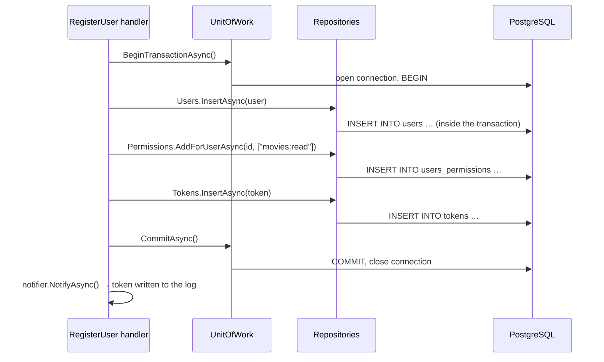

# Greenlight: the .NET version

This folder holds a .NET 10 port of the Go Greenlight API in the repository root. It has the same routes, the same database schema and the same error codes, without authentication, authorization or email. Instead of emailing the activation token, the API writes it to the log, where you can copy it.

Most of this document explains three things in detail:

1. **The unit of work.** How database access and transactions work with Dapper and Npgsql.
2. **The integration test setup.** What xUnit fixtures are, how they work, and how this project uses them.
3. **Observability.** OpenTelemetry, the Grafana stack, and the dashboard.

Everything else (configuration, endpoints, the Makefile) gets a shorter overview.

---

## Table of contents

1. [Quick start](#1-quick-start)
2. [Project layout](#2-project-layout)
3. [What happens when a request comes in](#3-what-happens-when-a-request-comes-in)
4. [Configuration](#4-configuration)
5. [Endpoints, validation and errors](#5-endpoints-validation-and-errors)
6. [Data access: Dapper, Npgsql and the unit of work](#6-data-access-dapper-npgsql-and-the-unit-of-work)
7. [Testing](#7-testing)
8. [Observability](#8-observability)
9. [Differences from the Go version](#9-differences-from-the-go-version)
10. [Troubleshooting](#10-troubleshooting)

---

## 1. Quick start

Requirements: the .NET 10 SDK, and Docker for the integration tests and the Grafana stack.

```bash
cd dotnetgreenlight

make otel/up        # optional: start Grafana + collector (http://localhost:3000, admin/admin)
make run/homelab    # run the API on http://localhost:5133 against the homelab database
# or
make run/locally    # same, against your local PostgreSQL

make test/unit      # unit tests (no Docker needed)
make test/all       # unit and integration tests (starts a PostgreSQL container)
make audit          # formatting check, build with warnings as errors, all tests

make publish        # Release build into ./bin/publish
make run/published  # run that build in the Production environment
```

To try the API, open `dotnetgreenlight/.http` in VS Code (REST Client extension) or Rider. To activate a user:

1. Run "Create user".
2. Find the line `Activation token for user 1: ABCD...` in the API log.
3. Paste the token into the "Activate user" request.

---

## 2. Project layout

```
dotnetgreenlight/
├── Greenlight.slnx                  # solution file (new XML format)
├── Directory.Build.props            # settings for every project (net10.0, nullable, warnings as errors)
├── Directory.Packages.props         # all NuGet versions in one place ("central package management")
├── global.json                      # SDK version and test runner (Microsoft.Testing.Platform)
├── Makefile
├── docker-compose.yml               # Grafana LGTM stack (observability)
├── observability/grafana/           # dashboard and its provisioning file
├── .http                            # sample requests
├── src/Greenlight.Api/
│   ├── Program.cs                   # builds the app and the middleware pipeline
│   ├── DependencyInjection.cs       # AddApi / AddData / AddObservability
│   ├── Endpoints.cs                 # maps every endpoint; the IEndpoint interface
│   ├── appsettings*.json            # configuration (see section 4)
│   ├── Properties/launchSettings.json
│   ├── Common/
│   │   ├── Api/                     # ApiOptions, Problems, validation filter, exception handler
│   │   ├── Data/UnitOfWork.cs       # IUnitOfWork and its implementation
│   │   ├── Observability/Telemetry.cs
│   │   └── GlobalConfiguration.cs   # global Dapper and FluentValidation settings
│   ├── Movies/                      # one feature folder ("vertical slice")
│   │   ├── CreateMovie.cs  GetMovies.cs  GetMovieById.cs  UpdateMovie.cs  DeleteMovie.cs
│   │   ├── Movie.cs  Runtime.cs  MovieRules.cs
│   │   └── MovieRepository.cs
│   ├── Users/
│   │   ├── RegisterUser.cs  ActivateUser.cs
│   │   ├── UserRepository.cs  TokenRepository.cs  PermissionRepository.cs
│   │   └── User.cs  Tokens.cs  PasswordHasher.cs  UserRules.cs  ActivationNotifier.cs
│   └── Monitoring/                  # Healthcheck.cs, DebugVars.cs
└── tests/
    ├── Greenlight.Api.UnitTests/         # validators, JSON converter, tokens, password hashing
    └── Greenlight.Api.IntegrationTests/  # real HTTP calls against a real PostgreSQL in Docker
        ├── Infrastructure/               # fixture, base class, helpers (section 7)
        ├── Movies/  Users/  Data/  Monitoring/
```

The folders are organized by feature, not by technical layer. Everything about "create movie" (request type, validator, handler) is in `Movies/CreateMovie.cs`. To add a feature, you add a file in the right folder, and you don't have to edit five layers.

---

## 3. What happens when a request comes in

```
HTTP request
  │
  ▼
UseExceptionHandler   ── turns unhandled exceptions into ProblemDetails (500, or 400 for bad JSON)
UseStatusCodePages    ── gives empty 404/405 responses a ProblemDetails body
UseRouting            ── picks the endpoint
UseCors               ── CORS policy from Api:Cors:TrustedOrigins
UseRateLimiter        ── only if Api:RateLimiting:Enabled (on in Production, off in Development)
UseRequestTimeouts    ── cancels the request's CancellationToken after Api:RequestTimeout (3s)
  │
  ▼
Endpoint filters      ── e.g. RequestValidationFilter (FluentValidation, returns 422)
  │
  ▼
Handler (HandleAsync) ── uses IUnitOfWork → repositories → Dapper → PostgreSQL
```

The Go version does the same steps with Chi middleware.

---

## 4. Configuration

### 4.1 Where settings live

Settings come only from the standard .NET configuration system. There are no custom flags and no hand-written parsing.

| File | Loaded when | Contains |
|---|---|---|
| `appsettings.json` | always | defaults: logging, Kestrel body limit (1 MB), `Api` section (timeout, CORS, rate limiting on) |
| `appsettings.Development.json` | environment = `Development` | homelab connection string, CORS origins, rate limiting **off**, OTLP endpoint |
| `appsettings.Production.json` | environment = `Production` | homelab connection string, rate limiting **on**, OTLP endpoint, less logging |

.NET merges these files: the environment-specific file overrides the base file. Environment variables override both, and command-line arguments override everything.

### 4.2 Launch profiles (`Properties/launchSettings.json`)

`dotnet run` and IDEs (Rider, VS, VS Code) read this file. It has two profiles. Both:

- run in the **Development** environment,
- listen on `http://localhost:5133` (`applicationUrl`),
- set one environment variable, `ConnectionStrings__Greenlight`. The double underscore means "nested key", so this overrides `ConnectionStrings:Greenlight`.

| Profile | Database |
|---|---|
| `homelab` | the homelab PostgreSQL |
| `local` | PostgreSQL on localhost |

`make run/homelab` is `dotnet run --launch-profile homelab`, and `make run/locally` is the same with the `local` profile.

The published app (`make run/published`) does **not** read `launchSettings.json`, which is a development-only file. The Makefile therefore sets `ASPNETCORE_ENVIRONMENT=Production` and `ASPNETCORE_URLS=http://localhost:5133` itself.

### 4.3 Typed options (`ApiOptions`)

The code never reads settings as strings, the way `config["Api:RateLimiting:Enabled"]` would. The `Api` section is bound to a class instead:

```csharp
public sealed class ApiOptions
{
    public TimeSpan RequestTimeout { get; set; } = TimeSpan.FromSeconds(3);
    public CorsSettings Cors { get; set; } = new();
    public RateLimitingSettings RateLimiting { get; set; } = new();
}
```

```csharp
services.AddOptions<ApiOptions>()
    .BindConfiguration("Api")       // read the "Api" section
    .Validate(o => o.IsValid(), "…")
    .ValidateOnStart();             // fail at startup, not on the first request
```

The built-in ASP.NET features are then configured from these options through DI. Here is how the CORS policy is built from `ApiOptions`:

```csharp
services.AddOptions<CorsOptions>()
    .Configure<IOptions<ApiOptions>>((o, api) => o.AddPolicy(CorsPolicy, p => p.WithOrigins(api.Value.Cors.TrustedOrigins) …));
```

Request timeouts and the rate limiter are set up the same way.

### 4.4 DI checks

`Program.cs` turns on `ValidateScopes` and `ValidateOnBuild` in every environment. If a service is registered with the wrong lifetime (for example a singleton that depends on the scoped database connection), the app fails at startup with a clear message. Without these checks you'd get subtle bugs later.

---

## 5. Endpoints, validation and errors

### 5.1 The endpoint pattern

This follows the structure of [StructuredMinimalApi](https://github.com/jonowilliams26/StructuredMinimalApi). Every endpoint is a class with one static `Map` method:

```csharp
public interface IEndpoint
{
    static abstract void Map(IEndpointRouteBuilder app);
}
```

```csharp
public sealed class DeleteMovieEndpoint : IEndpoint
{
    public static void Map(IEndpointRouteBuilder app) =>
        app.MapDelete("/{id:long}", HandleAsync).WithName("DeleteMovie");

    private static async Task<Results<NoContent, ProblemHttpResult>> HandleAsync(
        long id, IUnitOfWork unitOfWork, CancellationToken ct) { … }
}
```

`Endpoints.cs` groups them:

```csharp
app.MapGroup("/v1/movies").WithTags("Movies")
   .MapEndpoint<GetMoviesEndpoint>()
   .MapEndpoint<CreateMovieEndpoint>()
   …
```

The handler's parameters are filled in automatically:
- `long id` comes from the route,
- a request record (for example `CreateMovieRequest`) comes from the JSON body,
- `IUnitOfWork` and `TimeProvider` come from DI,
- `CancellationToken` is the request's token, which the timeout middleware cancels after 3 seconds.

The return type `Results<Ok<MovieResponse>, ProblemHttpResult>` lists every possible response. That makes the code self-documenting and feeds the OpenAPI document.

### 5.2 Validation

Validators use FluentValidation (`AbstractValidator<T>`). `.WithRequestValidation<TRequest>()` adds an endpoint filter that runs the validator before the handler. If validation fails, the handler never runs and the client gets **422** with the field errors:

```json
{
  "status": 422,
  "title": "One or more validation errors occurred.",
  "errors": { "title": ["must be provided"], "year": ["must be greater than 1888"] }
}
```

`GlobalConfiguration.cs` sets two global options so the behaviour matches the Go validator:
- only the **first** error per field is reported (`CascadeMode.Stop`),
- field names are snake_case, the same as in the JSON.

`MovieFieldsValidator<T>` holds the movie rules once. Both the create request and the merged movie in PATCH use it.

### 5.3 Errors

All errors are [RFC 7807 ProblemDetails](https://www.rfc-editor.org/rfc/rfc7807), with the same status codes as the Go API:

| Situation | Status | Where it's produced |
|---|---|---|
| validation failed | 422 | `RequestValidationFilter`, `Problems.FailedValidation` |
| not found / invalid id | 404 | `Problems.NotFound()`, or the router for unknown routes |
| edit conflict (stale `version`) | 409 | `Problems.EditConflict()` |
| bad JSON, unknown field, bad `"runtime"` | 400 | `GlobalExceptionHandler` |
| method not allowed | 405 | router and `UseStatusCodePages` |
| rate limited | 429 | rate limiter `OnRejected` |
| unexpected exception | 500 | `GlobalExceptionHandler` (logs the exception) |

Every problem response includes a `trace_id`. Paste it into Grafana Tempo to see that request's trace (section 8).

---

## 6. Data access: Dapper, Npgsql and the unit of work

### 6.1 The building blocks

| Piece | What it is | Lifetime in DI |
|---|---|---|
| `NpgsqlDataSource` | the connection pool for the database | **singleton** (one per app) |
| `NpgsqlConnection` | one connection taken from the pool | **scoped** (one per HTTP request) |
| `MovieRepository`, `UserRepository`, … | classes that run SQL with Dapper | scoped |
| `UnitOfWork` | groups the repositories and controls transactions | scoped |

Both connection registrations come from one line in `DependencyInjection.AddData`:

```csharp
builder.Services.AddNpgsqlDataSource(connectionString, connectionLifetime: ServiceLifetime.Scoped);
```

**What "scoped" means:** ASP.NET creates a new DI *scope* for every HTTP request. A scoped service is created once per scope, so everything inside one request gets the **same** instance, and it is disposed when the request ends. That's why all repositories in one request share the same `NpgsqlConnection`.

### 6.2 Dapper in two sentences

Dapper is a small library that runs SQL you write and maps the result rows to C# objects. It adds extension methods to the connection (`QueryAsync<T>`, `QuerySingleOrDefaultAsync<T>`, `ExecuteAsync`, `ExecuteScalarAsync<T>`).

```csharp
internal sealed class MovieRepository(NpgsqlConnection connection) : IMovieRepository
{
    public async Task<bool> DeleteAsync(long id, CancellationToken ct = default) =>
        await connection.ExecuteAsync(new CommandDefinition(
            "DELETE FROM movies WHERE id = @id", new { id }, cancellationToken: ct)) > 0;
}
```

Rules every repository follows:
- **Always parameterize.** `@id` with `new { id }`, never string concatenation. This prevents SQL injection.
- **Always use `CommandDefinition`.** It's the only way to pass the `CancellationToken` to Dapper.
- **No `SELECT *`.** Columns are listed explicitly.
- **snake_case columns map to PascalCase properties automatically**, because `Dapper.DefaultTypeMap.MatchNamesWithUnderscores = true` is set in `GlobalConfiguration.cs` (`created_at` → `CreatedAt`).
- **Lists use `= ANY(@codes)`** with a `string[]`, which is the PostgreSQL way.
- **Optimistic locking:** `UPDATE … WHERE id = @Id AND version = @Version RETURNING version`. If nothing comes back (`null`), someone else changed the row first, the repository returns `false`, and the endpoint returns 409.

### 6.3 What the unit of work is, and why we have it

A **unit of work** is a group of database changes that must succeed or fail together. For example, registering a user writes three things:

1. a row in `users`,
2. a row in `users_permissions` (`movies:read`),
3. a row in `tokens` (the activation token).

If step 3 fails, steps 1 and 2 must not stay in the database. A **transaction** guarantees that: either everything is committed, or everything is rolled back.

`IUnitOfWork` is the one object handlers use for data access:

```csharp
public interface IUnitOfWork
{
    IMovieRepository Movies { get; }
    IUserRepository Users { get; }
    ITokenRepository Tokens { get; }
    IPermissionRepository Permissions { get; }

    bool HasActiveTransaction { get; }
    Task BeginTransactionAsync(CancellationToken ct = default);
    Task CommitAsync(CancellationToken ct = default);
    Task RollbackAsync(CancellationToken ct = default);
}
```

A handler injects only `IUnitOfWork`, and reaches every repository through it (`unitOfWork.Users`, `unitOfWork.Tokens`, …).

### 6.4 How repositories join the transaction without being told

This is the part that looks like magic. The repositories never see the transaction, so how do their inserts end up in it?

1. `UnitOfWork` and all repositories get the **same** scoped `NpgsqlConnection`, as described in 6.1.
2. `BeginTransactionAsync` opens that connection and starts a transaction **on it**.
3. **Npgsql runs every command on a connection inside that connection's active transaction**, even when the command isn't explicitly given the transaction. So every repository call joins it.

```
               one HTTP request (one DI scope)
 ┌──────────────────────────────────────────────────────┐
 │                                                      │
 │   UnitOfWork ──┐                                     │
 │   UserRepo   ──┼──►  NpgsqlConnection  ──► BEGIN … COMMIT
 │   TokenRepo  ──┤      (the same object)              │
 │   PermRepo   ──┘                                     │
 │                                                      │
 └──────────────────────────────────────────────────────┘
```

We tested this against a real database: an insert made without passing the transaction disappeared after a rollback.

> **Note:** SQL Server's driver (`SqlClient`) behaves differently. It throws if a command isn't given the transaction. This design relies on Npgsql. That's fine here because the schema is PostgreSQL-only (`citext`, `text[]`).

### 6.5 When is the connection open?

Dapper has a convenient rule: **if the connection is closed, Dapper opens it before the call and closes it after.** If it's already open, Dapper leaves it alone.

| Situation | What happens |
|---|---|
| Read-only request (e.g. `GET /v1/movies`) | No transaction. Dapper opens the connection, runs the query, closes it, and the connection goes straight back to the pool. |
| Request with a transaction | `BeginTransactionAsync` opens the connection and keeps it open. `CommitAsync` / `RollbackAsync` end the transaction and close the connection again. |

This is the "open late, close early" rule from Milan Jovanović's Dapper guide: a connection is held only while it's actually needed.

### 6.6 A full walkthrough: `POST /v1/users`



The code, from `Users/RegisterUser.cs`:

```csharp
await unitOfWork.BeginTransactionAsync(ct);
try
{
    await unitOfWork.Users.InsertAsync(user, ct);
}
catch (DuplicateEmailException e)
{
    await unitOfWork.RollbackAsync(ct);
    return Problems.FailedValidation("email", e.Message);   // 422
}

await unitOfWork.Permissions.AddForUserAsync(user.Id, DefaultPermissions, ct);
var token = Tokens.Generate(user.Id, Tokens.ActivationTtl, TokenScopes.Activation, timeProvider);
await unitOfWork.Tokens.InsertAsync(token, ct);

await unitOfWork.CommitAsync(ct);
```

### 6.7 What if something goes wrong?

| What happens | Result |
|---|---|
| The handler calls `RollbackAsync()` | rolled back right away |
| The handler returns early **without** commit or rollback | rolled back when the request ends |
| An exception is thrown in the middle | rolled back when the request ends |
| A database error (e.g. a constraint violation) | rolled back when the request ends |

The automatic rollback works because `UnitOfWork` implements `IAsyncDisposable`. DI disposes every scoped service at the end of the request, and `DisposeAsync` rolls back any transaction that is still open. You can't forget to roll back.

There are also two guard rails:
- calling `BeginTransactionAsync` twice throws (no nested transactions),
- calling `CommitAsync` with no transaction throws.

### 6.8 Transactions and tracing

`BeginTransactionAsync` starts an OpenTelemetry span named `db.transaction`, and commit or rollback ends it with the tag `db.transaction.outcome = commit | rollback`. In a trace, you see the transaction as one block with its SQL statements inside.

### 6.9 Reads don't need a transaction

```csharp
var movie = await unitOfWork.Movies.GetByIdAsync(id, ct);   // just call it
```

Only start a transaction when several writes must succeed or fail together. A single statement is already atomic.

---

## 7. Testing

```bash
make test/unit          # fast, no Docker
make test/integration   # needs Docker
make test/all

# run one test or one class (xUnit v3 + Microsoft.Testing.Platform)
dotnet test --project tests/Greenlight.Api.IntegrationTests --filter-method "*Activate_with_valid_token*"
dotnet test --project tests/Greenlight.Api.IntegrationTests --filter-class "*UsersEndpointsTests"
```

`global.json` selects **Microsoft.Testing.Platform** as the test runner. On .NET 10 that's required for xUnit v3, which is why the commands use `--project`.

### 7.1 Unit tests

Unit tests check small pieces in isolation, with no database and no HTTP:
- validators (movie rules, filters, user and token rules),
- the `"107 mins"` JSON converter, including every invalid case from the Go tests,
- token generation (26 characters, unique, SHA-256 hash, expiry),
- bcrypt hashing, including verifying a hash produced by **Go's** bcrypt library.

They're plain xUnit tests:

```csharp
public sealed class TokensTests
{
    [Fact]                                     // one test
    public void Tokens_are_unique() { … }
}

[Theory]                                       // the same test with different data
[InlineData("abc", "must be an integer value")]
[InlineData("0",   "must be greater than zero")]
public void Invalid_page(string page, string message) { … }
```

Assertions use **Shouldly** (`value.ShouldBe(expected)`), which gives readable failure messages.

### 7.2 Integration tests: the idea

Integration tests check the **whole** app: a real HTTP request goes through the real pipeline, validation, handler and Dapper, into a **real PostgreSQL**. There are no mocks for the database.

Three tools make that possible:

| Tool | What it does |
|---|---|
| **Testcontainers** | starts a throwaway PostgreSQL 17 in Docker for the test run, then removes it |
| **WebApplicationFactory** (`Microsoft.AspNetCore.Mvc.Testing`) | starts our API **in memory** (no real port) and gives us an `HttpClient` that talks to it |
| **Respawn** | empties all tables between tests, so each test starts with a clean database |

Starting a container takes a few seconds, and starting the app takes a little time too. We **don't** want to do that for each of the ~50 tests. We want to do it **once** and share it. That's exactly what xUnit **fixtures** are for.

### 7.3 xUnit fixtures explained from scratch

#### Rule 1: xUnit creates a new test class instance for every test

This surprises people. If a class has 10 test methods, xUnit creates the class **10 times**, once per test:

```csharp
public class MyTests
{
    public MyTests() { Console.WriteLine("constructor"); }   // runs before EVERY test

    [Fact] public void A() { }
    [Fact] public void B() { }
}
// output: "constructor" twice
```

That's deliberate: tests can't accidentally share state through fields. But it also means you can't put expensive setup (like starting Docker) in the constructor, because it would run for every test.

#### Rule 2: `IAsyncLifetime` adds async setup and teardown

Constructors can't `await`, so xUnit offers `IAsyncLifetime`:

```csharp
public class MyTests : IAsyncLifetime
{
    public ValueTask InitializeAsync() { … }   // runs after the constructor, before the test
    public ValueTask DisposeAsync()    { … }   // runs after the test
}
```

The order for **each** test is: constructor → `InitializeAsync` → test method → `DisposeAsync`.

#### Rule 3: a fixture is an object xUnit creates once and shares

A **fixture** is a normal class that xUnit creates **once** and hands to many tests. It's the place for expensive things: a database container, a web server, a big file.

You don't create a fixture yourself. You **ask for it in the test class constructor**, and xUnit injects the shared instance:

```csharp
public class MyTests(ExpensiveThing shared)   // xUnit passes the shared instance in
{
    [Fact] public void A() { /* use shared */ }
}
```

If the fixture implements `IAsyncLifetime`, xUnit calls its `InitializeAsync` once before the first test that uses it, and `DisposeAsync` once after the last.

#### The three kinds of fixtures

The difference between them is **how widely** the fixture is shared.

| Kind | How you declare it | Shared by | Created |
|---|---|---|---|
| **Class fixture** | `class MyTests : IClassFixture<T>` | all tests in **one class** | once per class |
| **Collection fixture** | `[CollectionDefinition("x")] class X : ICollectionFixture<T>`, then `[Collection("x")]` on each test class | all tests in **all classes of that collection** | once per collection |
| **Assembly fixture** (xUnit v3) | `[assembly: AssemblyFixture(typeof(T))]` | **every** test in the project | once per test project |

The other important detail is **parallelism**. xUnit runs different *collections* in parallel, but tests **inside one collection run one after another**. By default every test class is its own collection.

- **Class fixture:** each test class would start its **own** PostgreSQL container. With 6 test classes that's 6 containers, slow but isolated.
- **Collection fixture:** **one** container for all classes in the collection, and their tests run **one at a time**. That's exactly what we need, because all tests share one database and Respawn wipes it before every test. Two tests running at the same time would wipe each other's data.
- **Assembly fixture:** also one container, but tests in different classes would still run in parallel, which would break the database reset for the reason above.

**That's why this project uses a collection fixture.**

### 7.4 How it's wired in this project

All of it is in `tests/Greenlight.Api.IntegrationTests/Infrastructure/GreenlightApiFactory.cs`, which has three parts.

#### Part 1: the fixture, `GreenlightApiFactory`

```csharp
public sealed class GreenlightApiFactory : WebApplicationFactory<Program>, IAsyncLifetime
```

It's two things at once:
- a `WebApplicationFactory<Program>`, so it can start our API in memory,
- an `IAsyncLifetime`, so xUnit runs its `InitializeAsync` / `DisposeAsync` **once**.

**`InitializeAsync()` runs once, before any test:**

```csharp
await _postgres.StartAsync();                       // 1. start PostgreSQL in Docker
await Migrations.ApplyAsync(ConnectionString);      // 2. create the schema
_respawner = await Respawner.CreateAsync(…);        // 3. prepare the "empty all tables" tool
```

1. **Testcontainers** starts `postgres:17-alpine` on a random free port. `ConnectionString` points at it.
2. **Migrations** reads the **Go project's** Goose migration files (`internal/data/migrations/*.sql`). The test `.csproj` copies them into the test output folder. The code runs the `-- +goose Up` part of each file in order, so the test database has exactly the same schema as the real one. It also enables the `citext` extension first.
3. **Respawn** inspects the schema once and remembers how to empty every table in the right order (child tables before parents). The `permissions` table is skipped because it holds seed data from a migration.

**`ConfigureWebHost()` customizes the app for tests.** It runs when the app is first started, which happens on the first `CreateClient()`:

```csharp
builder.UseEnvironment("Testing");                                     // not Development/Production
builder.UseSetting("ConnectionStrings:Greenlight", ConnectionString);  // use the container DB
builder.UseSetting("Api:RateLimiting:Enabled", "false");               // tests send many requests

builder.ConfigureTestServices(services =>
{
    services.RemoveAll<IActivationNotifier>();                // replace the real notifier…
    services.AddSingleton<IActivationNotifier>(ActivationNotifier);   // …with one that records tokens
    services.RemoveAll<TimeProvider>();
    services.AddSingleton<TimeProvider>(Time);                // a clock the tests can move forward
});
```

- **Environment `Testing`:** neither `appsettings.Development.json` nor `appsettings.Production.json` is loaded, so tests never touch homelab. With no OTLP endpoint configured, no telemetry is exported.
- **`UseSetting`** overrides configuration values. These are read during startup, which is why the container must already be running. xUnit guarantees that: the fixture's `InitializeAsync` finishes before any test, so before the first `CreateClient()`.
- **`ConfigureTestServices`** replaces real services with test versions **after** `Program.cs` has registered everything:
  - **`CapturingActivationNotifier`:** the real one writes the token to the log; this one stores it in memory, so a test can read it with `Factory.ActivationNotifier.Single().Token`.
  - **`FakeTimeProvider`:** a controllable clock. `Factory.Time.Advance(TimeSpan.FromDays(3))` makes "3 days pass", which is how we test that expired activation tokens are rejected without waiting 3 days. This works because the app code asks for `TimeProvider` from DI and never calls `DateTime.Now` for token expiry.

**`ResetDatabaseAsync()`** empties every table with Respawn and clears the captured tokens. Each test calls it before running (see part 3).

**`DisposeAsync()`** runs once, after the last test. It stops the app, then stops and removes the container.

#### Part 2: the collection definition

```csharp
[CollectionDefinition(Name)]
public sealed class ApiCollection : ICollectionFixture<GreenlightApiFactory>
{
    public const string Name = "api";
}
```

This empty class tells xUnit: there is a collection called `"api"`, and it has one shared `GreenlightApiFactory`. It has no code; xUnit reads only the attribute and the interface.

#### Part 3: the base class every integration test inherits

```csharp
[Collection(ApiCollection.Name)]                       // join the "api" collection → get the shared factory
public abstract class IntegrationTest(GreenlightApiFactory factory) : IAsyncLifetime
{
    protected GreenlightApiFactory Factory { get; } = factory;
    protected HttpClient Client { get; private set; } = null!;
    protected static CancellationToken Ct => TestContext.Current.CancellationToken;

    public async ValueTask InitializeAsync()           // before EACH test
    {
        await Factory.ResetDatabaseAsync();            // clean database
        Client = Factory.CreateClient();               // fresh HttpClient for the in-memory API
    }

    public ValueTask DisposeAsync() { Client.Dispose(); … }   // after EACH test

    protected Task<T> WithUnitOfWorkAsync<T>(Func<IUnitOfWork, Task<T>> action) { … }
}
```

- `[Collection("api")]` is inherited, so every class deriving from `IntegrationTest` is in the collection and gets the shared factory.
- `InitializeAsync` here is the **per-test** setup, because the test class is recreated for every test (Rule 1). It gives each test an empty database and a new client.
- `Ct` is xUnit's cancellation token for the current test. Passing it to async calls lets xUnit cancel a hanging test.
- `WithUnitOfWorkAsync` creates a DI scope (like a mini request), gets a real `IUnitOfWork`, and runs your code with it. Tests use this to check or prepare data **directly in the database**, without HTTP:

```csharp
var permissions = await WithUnitOfWorkAsync(uow => uow.Permissions.GetAllForUserAsync(user.Id, Ct));
permissions.ShouldBe(["movies:read"]);
```

### 7.5 The whole timeline of one test run

```
dotnet test
│
├─ xUnit finds all classes with [Collection("api")]
│
├─ GreenlightApiFactory created                          ── ONCE
│   └─ InitializeAsync: start Docker PostgreSQL, run migrations, prepare Respawn
│
├─ for each test in the collection (one at a time):
│   ├─ new MoviesEndpointsTests(factory)                 ── constructor, the shared factory is injected
│   ├─ IntegrationTest.InitializeAsync                   ── empty all tables, new HttpClient
│   │     (the first CreateClient() also starts the API in memory → ConfigureWebHost runs, ONCE)
│   ├─ [Fact] method runs                                ── HTTP calls → real pipeline → real DB
│   └─ IntegrationTest.DisposeAsync                      ── dispose the HttpClient
│
└─ GreenlightApiFactory.DisposeAsync                     ── ONCE: stop the API, remove the container
```

### 7.6 Writing a new integration test

```csharp
using System.Net;
using Greenlight.IntegrationTests.Infrastructure;

namespace Greenlight.IntegrationTests.Movies;

public sealed class MyNewTests(GreenlightApiFactory factory) : IntegrationTest(factory)
{
    [Fact]
    public async Task Creating_a_movie_makes_it_listable()
    {
        // Arrange + Act: real HTTP calls
        var created = await Client.PostJsonAsync("/v1/movies",
            new { title = "Heat", year = 1995, runtime = "170 mins", genres = new[] { "crime" } }, Ct);
        created.StatusCode.ShouldBe(HttpStatusCode.Created);

        // Assert through HTTP...
        var list = await (await Client.GetAsync("/v1/movies", Ct)).ReadAsync<MovieDto[]>(Ct);
        list.ShouldHaveSingleItem().Title.ShouldBe("Heat");

        // ...or directly in the database
        var all = await WithUnitOfWorkAsync(uow => uow.Movies.GetAllAsync(Ct));
        all.Count.ShouldBe(1);
    }
}
```

All you need is to **inherit `IntegrationTest` and accept the factory in the constructor**. The database is already empty, and `Client` is ready.

Helpers in `Infrastructure/HttpExtensions.cs`:
- `PostJsonAsync` / `PutJsonAsync` / `PatchJsonAsync` send JSON with snake_case names.
- `PostRawAsync` sends a raw string, for testing malformed JSON.
- `ReadAsync<T>` / `ReadJsonAsync` read the response.
- `ShouldBeProblemAsync(422, Ct)` checks that the response is ProblemDetails with that status, and returns its body.
- `problem.Errors("title")` returns the validation messages for one field.

### 7.7 What the integration tests cover

| Area | Examples |
|---|---|
| Movies | create (201 + `Location`), 422 per field, 400 for a bad runtime or an unknown field, list, get (404 for unknown or invalid ids), PATCH full and partial, delete then 404, 405 |
| Users | register (202, the token is captured, the `movies:read` permission row exists, bcrypt hash stored), duplicate email (422, also with different upper/lower case), activate, reusing a token, an expired token (via `FakeTimeProvider`), malformed tokens |
| Unit of work | commit persists; explicit rollback, a missing commit, an exception and a DB error all roll back; nested transactions are rejected; all repositories share one transaction |
| Repository | optimistic locking: a second update with a stale version is an edit conflict |
| Monitoring | healthcheck shape, `/debug/vars` snapshot |

---

## 8. Observability

### 8.1 The three signals

| Signal | Answers | Examples here |
|---|---|---|
| **Metrics** | "How much, how fast, how often?" (numbers over time) | requests/s, p95 latency, DB pool usage, GC, CPU |
| **Traces** | "What happened inside **this** request, and how long did each step take?" | `GET /v1/movies/{id}` → `postgresql` query (2 ms) |
| **Logs** | "What did the app say?" | `Activation token for user 1: …`, errors with stack traces |

**OpenTelemetry (OTel)** is the vendor-neutral standard for producing all three. The app produces telemetry with the OTel SDK and **pushes** it over the **OTLP** protocol to a collector. Any backend can be used (Grafana, Jaeger, Datadog, …) without changing app code.

### 8.2 What the app sets up (`DependencyInjection.AddObservability`)

```csharp
builder.Services.AddOpenTelemetry()
    .ConfigureResource(r => r
        .AddService("greenlight-api", serviceVersion: Telemetry.Version)          // who is sending
        .AddAttributes([new("deployment.environment.name", "development")]))      // which environment
    .WithTracing(t => t
        .AddSource("Greenlight.Api")             // our own spans (db.transaction)
        .AddAspNetCoreInstrumentation()          // one span per incoming request
        .AddHttpClientInstrumentation()          // spans for outgoing HttpClient calls
        .AddNpgsql())                            // one span per SQL command
    .WithMetrics(m => m
        .AddMeter("Npgsql")                      // connection pool and query metrics
        .AddAspNetCoreInstrumentation()          // http.server.request.duration, Kestrel, rate limiting
        .AddHttpClientInstrumentation()          // http.client.* (when there are outgoing calls)
        .AddRuntimeInstrumentation())            // GC, memory, CPU, thread pool, exceptions
    .WithLogging(…);                             // ILogger output also goes out as OTel logs

if (!string.IsNullOrWhiteSpace(builder.Configuration["OTEL_EXPORTER_OTLP_ENDPOINT"]))
    otel.UseOtlpExporter();                      // send all three signals over OTLP
```

Points worth knowing:
- **There are no custom metrics.** The number of requests, status codes and latency all come from ASP.NET Core's built-in `http.server.request.duration` histogram. A histogram also has a count, so it gives both "how many" and "how fast", labelled by route, method and status code.
- **Export only happens when an endpoint is configured.** `OTEL_EXPORTER_OTLP_ENDPOINT` is the standard OTel setting. It's `http://localhost:4317` in the Development and Production appsettings, and not set in tests, so tests export nothing.
- **Resource attributes** (`service.name`, `service.version`, `deployment.environment.name`) are attached to every metric, span and log. That's how Grafana can filter by environment.
- **Outgoing HTTP** (`AddHttpClientInstrumentation`) is ready but produces no data yet, because the API doesn't call other services. Once it does, those calls appear as child spans and as `http_client_*` metrics automatically.

### 8.3 The local backend: Grafana LGTM (`docker-compose.yml`)

`make otel/up` starts **one** container, `grafana/otel-lgtm`, which bundles:

```
 Greenlight API ──OTLP (4317)──►  OpenTelemetry Collector ──┬──► Prometheus  (metrics)
                                                            ├──► Tempo       (traces)
                                                            └──► Loki        (logs)
                                                                       ▲
                                                Grafana (http://localhost:3000) reads all three
```

- Login: `admin` / `admin`.
- Data is kept in the Docker volume `lgtm-data`, so it survives `make otel/down` / `otel/up`. Very recent traces can be lost when the container restarts.
- `make otel/down` stops it.

### 8.4 The dashboard

The **Greenlight API** dashboard is loaded automatically. Find it under Dashboards → Greenlight → Greenlight API, or at http://localhost:3000/d/greenlight-api.

How it's loaded:
- `observability/grafana/dashboards/greenlight-api.json` is the dashboard itself.
- `observability/grafana/dashboards.yaml` tells Grafana to load every JSON file in that folder.
- `docker-compose.yml` mounts both into the container.

Filters at the top: **Environment** (development / production) and **Instance** (one running process).

| Row | Panels | Metric behind it |
|---|---|---|
| Overview | requests/s, 5xx %, 4xx %, p95 latency, total requests in range, average latency | `http_server_request_duration_seconds` |
| HTTP | requests per route, responses per status code, p50/p95/p99, p95 per route, active requests/connections, rate limiter decisions | `http_server_*`, `kestrel_*`, `aspnetcore_rate_limiting_*` |
| Database | pool connections (idle/used vs max), queries/s, query latency, bytes read/written, connection open time | `db_client_*` (Npgsql) |
| .NET runtime | CPU, memory, GC collections, thread pool, exceptions, GC pause time | `dotnet_*` |
| Logs & traces | the app's logs; recent traces (click one to open it) | Loki, Tempo |

To **change the dashboard:** edit it in Grafana. Provisioned dashboards can't be saved over directly, so use Share → Export → copy the JSON and paste it over `greenlight-api.json`. Grafana reloads the file within about 30 seconds.

### 8.5 Exploring on your own (Grafana → Explore)

**Metrics (Prometheus).** OTel names change when they reach Prometheus: dots become underscores, and unit and `_total` suffixes are added. So `http.server.request.duration` (seconds) becomes `http_server_request_duration_seconds_count` / `_sum` / `_bucket`. Example queries:

```promql
# requests per second by route
sum by (http_route) (rate(http_server_request_duration_seconds_count{job="greenlight-api"}[5m]))

# p95 latency
histogram_quantile(0.95, sum by (le) (rate(http_server_request_duration_seconds_bucket{job="greenlight-api"}[5m])))

# DB connections in use
sum by (db_client_connection_state) (db_client_connection_count{job="greenlight-api"})
```

`job` is the service name, and `instance` is the process id that OTel generates.

**Traces (Tempo):** query `{resource.service.name="greenlight-api"}`. Open a trace to see the waterfall. For `POST /v1/users` you see the HTTP span, the `db.transaction` span, and the three `INSERT` statements inside it.

**Logs (Loki):** query `{service_name="greenlight-api"}`. Log lines written during a request carry its trace id, so you can jump from a log line to the trace.

**From an error response to its trace:** every ProblemDetails body contains `trace_id`. Paste it into Tempo's search to see exactly what happened in that failed request.

### 8.6 `/debug/vars`

This is a quick JSON snapshot of the process, the counterpart of Go's expvar. It contains version, timestamp, thread pool stats, memory and GC counts. Request counts are **not** here; they're in Grafana, from the built-in HTTP metrics.

---

## 9. Differences from the Go version

| Topic | Go | .NET |
|---|---|---|
| Auth (tokens, permissions middleware, login) | yes | not included (permission rows are still written at registration) |
| Activation token delivery | email (SMTP) | written to the log (`LoggingActivationNotifier`) |
| SQL | sqlc-generated | handwritten SQL with Dapper (same queries) |
| Transactions | `pgx` `tx` with `queries.WithTx(tx)` | `IUnitOfWork` sharing one scoped connection |
| Configuration | CLI flags | appsettings + env vars + launch profiles |
| Errors | `{"error": …}` | RFC 7807 ProblemDetails (same status codes) |
| Metrics | expvar (`/debug/vars`) | OpenTelemetry + Grafana; `/debug/vars` is a process snapshot |
| Schema | Goose migrations | **the same** Goose migrations (tests apply them; `make db/up` runs Goose) |
| `GET /v1/movies` filters | validated, not applied | the same: validated, full list returned |
| CORS methods | no PATCH | PATCH allowed |

---

## 10. Troubleshooting

| Problem | Cause and fix |
|---|---|
| Integration tests fail immediately with Docker errors | Docker isn't running, or your user can't reach `/var/run/docker.sock`. |
| `Connection string 'Greenlight' is not configured` at startup | The environment has no `ConnectionStrings:Greenlight`. Run through a launch profile (`make run/homelab`), or set `ConnectionStrings__Greenlight`. |
| The published app listens on port 5000 | It was started without `ASPNETCORE_URLS`; use `make run/published`. |
| Lots of 429 responses | You're running in Production, where rate limiting is on (10 requests / 5 s per IP). |
| Nothing shows up in Grafana | Is LGTM running (`make otel/up`)? Is the app in Development/Production (not Testing)? Metrics arrive in batches, so wait about 60 seconds. |
| A DI error mentions "scoped service from root provider" | A singleton depends on a scoped service (e.g. the connection). The DI checks in `Program.cs` catch this at startup on purpose. |
| `dotnet test` complains about VSTest | Use `dotnet test --project …`; `global.json` selects Microsoft.Testing.Platform, which xUnit v3 needs on .NET 10. |
